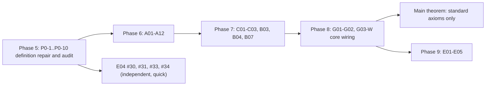

# Completion Plan: Sorry-Free Genus-Zero Gromov Compactness

**Status date:** 4 November 2026 · **Baseline commit:** `f385f4b` (`main`) · **Toolchain:** Lean `v4.16.0`, Mathlib `v4.16.0`
**Companion documents:** `gromov_compactness.pdf` (specification), `GROMOV_COMPACTNESS_BLUEPRINT.md`, `AUTOFORMALIZATION_PLAN.md`, `report/gromov_lean_report.tex`

---

## 0. Binding Completion Directive

> [!IMPORTANT]
> **A phase cannot be marked complete unless every declaration in its scope is sorry-free.**
>
> Concretely, a phase (and each of its milestones) may be declared complete **only if all of the following hold**, verified by commands re-run by an independent auditor (not taken from agent summaries):
>
> 1. `lake build GromovCompactness` succeeds.
> 2. The library-wide axiom census (`lake env lean tests/ReportAxiomCensus.lean`, or the phase-scoped census of Task P0-6) reports **zero `sorryAx`-dependent declarations** among the phase's declarations **and in their full dependency closure**.
> 3. No `sorry`, `admit`, `axiom`, `@[implemented_by]`, `unsafe`, `native_decide`, or `:= by sorry` auto-parameter default occurs in the phase's files (comment-stripped grep returns nothing).
> 4. No **definition** in scope is built from `sorry` (a `sorry`-defined `def`/`instance` makes every theorem about it meaningless, even if those theorems are sorry-free).
> 5. Statements were not weakened to make them provable. Any statement change needs reviewer sign-off and a matching blueprint update, recorded in the milestone hand-off.
> 6. A **reduction theorem** (proved, but taking an open statement as a hypothesis) does **not** count as completing the contract of that hypothesis.
> 7. `\leanok` appears in `blueprint/src/content.tex` only on declarations satisfying 1–4.
>
> **Project completion** additionally requires
> `#print axioms GromovCompactness.gromov_compactness_genus_zero` → `[propext, Classical.choice, Quot.sound]`.
>
> A scaffolding stage ("Model A") may introduce new `sorry` stubs. Only the proof stage ("Model B") can close a phase, and it is bound by this directive. Gates must **reject** any completion claim that rests on agent-reported "zero-sorry" status without the census output attached.

---

## 1. Current Formal State (kernel-verified, 4 Nov 2026)

| Metric | Value |
|---|---|
| Modules / lines | 32 / ≈8,700 |
| Constants depending only on standard axioms | 1,194 (748 theorems), incl. compiler-generated |
| Constants depending on `sorryAx` | 54 (48 theorems) |
| Declarations containing a direct `sorry` | **45** |
| Project `axiom` declarations / non-standard axioms | 0 / 0 |
| `gromov_compactness_genus_zero` | depends on `sorryAx` (via `gromov_compactness_core`) |
| `gromov_compactness_component_bounds` | standard axioms only |

> [!WARNING]
> **The core theorem is not wired to the lemma stack.** `gromov_compactness_core` is proved by a single `sorry` and does not invoke the concentration, bubbling, assembly or stabilization lemmas. Most open lemmas are also not used by anything (see the "Used by" column below). Closing every leaf lemma would **not** by itself close the main theorem. An explicit wiring proof (Task G03-W) is required.

---

## 2. Phase 5 (Blockers): Definition Repair and Statement Audit

These must be done **before** any proof effort on the open lemmas. Several open statements are likely **false** under the current definitions.

| ID | Priority | Problem | Required fix | Acceptance |
|---|---|---|---|---|
| **P0-1** | **Critical** | **Energy measure lacks the chart Jacobian.** `energyMeasureExtended u = map stereo_chart.symm (volume.withDensity (e ∘ stereo_chart.symm))`, where `e = riemannianEnergyDensity` is the round-metric density (computed in Mathlib's sphere chart at `z`, which is isometric at its centre). Lebesgue measure on ℂ with density tending to `e(north_pole) > 0` is infinite, so `totalEnergy = toReal ∞ = 0` for generic maps. Then `sphere_energy_gap` is false, `E(u_n) ≤ B` is vacuous, and the master theorem is likely false as stated. | Redefine energy either (a) intrinsically: `(volume.toSphere).withDensity (ofReal ∘ e)` using Mathlib's `Measure.toSphere`, or (b) chartwise: density `½(|∂ₓ(u∘σ⁻¹)|² + |∂ᵧ(u∘σ⁻¹)|²)` against Lebesgue on ℂ. Prove a finiteness lemma for smooth `u` **before** any `toReal`, as `gromov_compactness.pdf` §4.1 requires. | Lean test: a concrete nonconstant smooth `u` has finite, positive `energyMeasureExtended`. `toReal` used only after finiteness. |
| **P0-2** | Critical | `energy_conformal_invariant` takes the invariance itself (`h_conf`) as a hypothesis. | Prove Möbius invariance of the repaired energy measure unconditionally (affine maps via change of variables on ℂ; inversion via the second chart, or intrinsically via isometry/conformality on S²). | Theorem without `h_conf`, sorry-free. |
| **P0-3** | High | `ClosedTameTarget.ω_closed : Prop` and `J_smooth : Prop` are unconstrained; ω has no smoothness. A07 (Stokes) and E03 (homology) need `dω = 0`, and A02/A04 need smooth `J`, ω. Same issue for `VaryingAlmostComplexStructures.J_seq_smooth`. | State smoothness of ω and J chartwise (`ContMDiff` of the bundle maps in trivializations, or `ContDiffOn` of coordinate representations). State closedness via Mathlib's `extDeriv` on model-space coordinate representations if available in the pinned Mathlib; otherwise define chartwise `dω = 0` explicitly. | Fields are concrete predicates; F01 lemmas still compile; reviewer sign-off. |
| **P0-4** | High | `scalar_mean_value_inequality` assumes `-b e² ≤ Δe`, but `bochner_differential_inequality` provides `-b e² - c e ≤ Δe`. The two cannot be composed for `epsilon_regularity`. | Generalize A01 to `Δe ≥ -b e² - c e` (standard: absorb via `r ≤ 1`), or strengthen A02 to drop `c`. | A03 is provable from A01 + A02 by statement inspection. |
| **P0-5** | High | Density convention in A02/A03: the energy density is evaluated in Mathlib's chart at `z` but differentiated in `stereo_chart` coordinates. Uniform `b, c` over all `w ∈ ℂ` may fail because of the conformal factor. | After P0-1, restate A02/A03 for the **Euclidean** density of `u ∘ σ⁻¹` on discs in ℂ (or on unit discs in either chart), as in Zinger Prop. 4.1. | Statements audited against Zinger/McDuff–Salamon by a reviewer. |
| **P0-6** | High | The census takes ~12 min and is not phase-scoped. | Add `tests/PhaseAxiomCensus.lean` taking a module prefix. Reuse one `CollectAxioms.State` across declarations (single traversal) and print the **names** of `sorryAx`-dependent constants. | Runs in < 3 min; output attached to every gate. |
| **P0-7** | Medium | `assemble_global_frames` ignores its data (`_local_centers`, `_local_scales`): the frames it produces are unrelated to the bubbling. | Restate so that the frames are built from the `CalibratedRescaling` data of each tree level (`φ_{w,n} = φ_{v,n} ∘ (z ↦ a_n + λ_n z)`). | Reviewer confirms that G03-W can consume it. |
| **P0-8** | Medium | `ModuliSpace`: `GromovConverges`, `gromovDist`, `moduliSpaceMetric` and the predicate of `ModuliSpaceInClass` are **defined** by `sorry`. `moduli_space_t2` follows from the `sorry` metric and has no content. | Define the Gromov topology via neighbourhoods/sequential convergence (McDuff–Salamon §5.6). Prove T2 from uniqueness of Gromov limits. Defer metrizability. Define `represents_homology_class` concretely (after E03). | No `sorry`-built definitions in `ModuliSpace.lean`. |
| **P0-9** | Medium | The `Main.lean` docstring claims `gromov_compactness_genus_zero` has no `sorryAx`. Several "Zero-sorry" docstrings describe reductions. | Correct the docstrings. Label reductions "conditional" (as `gromov_compactness.pdf` §4.1 requires). | Grep audit by the forensic auditor. |
| **P0-10** | **High** | **`A04` $W^{k+1,p}$ Calderón–Zygmund bottleneck & `A11 → A05` regularity bridge.** `interior_cauchy_riemann_estimate` (`A04a`) and `morrey_sobolev_embedding` (`A04b`) were stated in $W^{k,p}$ (requiring Calderón–Zygmund singular integrals, absent from Mathlib), while `puncture_sobolev_extension` (`A11`) only concluded `Continuous u_ext` whereas `nonlinear_elliptic_bootstrap` (`A05`) requires `WeakJHolomorphicOn` ($C^1$). | Per the approved `holder_schauder_a04_plan.md`: (1) Add concrete $C^{k,\alpha}$ Hölder norms (`supNormOn`, `holderSeminorm`, `derivHolderSeminorm`, `ckHolderNorm`) in `EllipticBootstrap.lean` (retaining `sobolevNorm` helpers for compatibility); (2) Restate `interior_cauchy_riemann_estimate` (`A04a`) in $C^{k,\alpha}$ (Schauder interior estimate via Mathlib's `DiffContOnCl.circleIntegral_sub_inv_smul` + Korn–Lichtenstein Pompeiu kernel bound); (3) Replace `morrey_sobolev_embedding` (`A04b`) with `cauchy_pompeiu_holder_gain` ($\|f\|_{C^{0,\alpha}(D_r)} \le C(\|\bar{\partial} f\|_{C^0(D_R)} + \|f\|_{C^0(D_R)})$); (4) Prove the zero-`sorry` $C^{k,\alpha}$ induction chain (`elliptic_bootstrap_holder*`); (5) Strengthen `puncture_sobolev_extension` (`A11`) to conclude `WeakJHolomorphicOn I u_ext Set.univ` across the puncture, making `h_bootstrap_ext` in `SingularityRemoval.lean` a zero-`sorry` corollary of `A05`. | `A04a`/`A04b` restated in $C^{k,\alpha}$; `elliptic_bootstrap_holder` and the `A11 → A05` bridge in `SingularityRemoval.lean` proved with zero `sorry`; blueprint Lemma `a04:elliptic_toolkit` updated. |
| **P0-11 (`G03-W`)** | **Critical** | **Core theorem call-graph is disconnected.** `gromov_compactness_core` (`G03`), `stabilize_prestable_tree` (`G02`), `assemble_prestable_limit` (`G01`), `resolve_single_defect_tree` (`B07`), and `weak_energy_measure_compactness` (`C01`) are standalone `sorry`s rather than calling the layers below them (`stabilize_prestable_tree` dropped `frame_collapse` and `energy_ident` from `PrestableLimitData`). | Pull `G03-W` into Phase 5: (1) Enrich `stabilize_prestable_tree` (`G02`) to return all 5 `CompactnessWitness` fields and wire it via well-founded induction on `card V` to `prune_degree_one_root` and `suppress_degree_two_root`; (2) Prove `gromov_compactness_core` (`G03`) and `gromov_subsequence_alternative` with **zero direct `sorry`** from `G01 + G02`; (3) Wire `assemble_prestable_limit` (`G01`) to `C02 + C03 + B07`; (4) Wire `resolve_single_defect_tree` (`B07`) via `energy_rank_induction` + `B06` to `B04`; (5) Prove `weak_energy_measure_compactness` (`C01`) with **zero direct `sorry`** from `weak_measure_compactness`; (6) Add `#audit_wiring` to `tests/PhaseAxiomCensus.lean` verifying `gromov_compactness_genus_zero` transitively references the full contract stack. | Zero direct `sorry` in `gromov_compactness_core`, `gromov_subsequence_alternative`, `stabilize_prestable_tree`, `resolve_single_defect_tree`, and `weak_energy_measure_compactness`; `#audit_wiring` passes. |

---

## 3. Inventory of the 45 Open Declarations

Difficulty: **S** (≤ 1 day agent work), **M** (days), **L** (week+), **XL** (needs new Mathlib-scale infrastructure).
"Used by" = other project files referencing the declaration today.

### 3.1 Phase 6: Local Analysis (13 declarations)

| # | Declaration | File | Contract | Statement (abridged) | Used by | Diff. | Route / Mathlib inputs |
|---|---|---|---|---|---|---|---|
| 1 | `scalar_mean_value_inequality` | `Analysis/Monotonicity.lean` | A01 | `e ≥ 0`, `Δe ≥ -b e²`, `∫_{D_r} e < η` ⇒ `sup_{D_{r/2}} e ≤ C r⁻² ∫_{D_r} e` | EpsilonRegularity | M | Heinz trick: maximize `(r-|z|)² e(z)`, then sub-mean-value property for subharmonic functions. Mathlib: `InnerProductSpace.HarmonicOnNhd`, circle averages; may need a sub-mean-value lemma for C² functions with `Δf ≥ -K`. Fix P0-4 first. |
| 2 | `bochner_differential_inequality` | `Analysis/Bochner.lean` | A02 | `Δe ≥ -b e² - c e` in the chart | EpsilonRegularity | L | Coordinate computation in a chart of M, with bounds on ∇J, curvature via compactness. Needs P0-3/P0-5. Alternative: avoid Bochner by proving ε-regularity via the Hofer route + local compactness (Zinger §4). |
| 3 | `epsilon_regularity` | `Analysis/EpsilonRegularity.lean` | A03 | `E(u; D_r) < ε_reg` ⇒ `sup_{D_{r/2}} e ≤ C r⁻² E` | HoferRescaling | M | From A01 + A02 by scaling. Proved lemmas in `HoferRescaling.lean` already bridge `Mathlib.Analysis.Hofer`. |
| 4 | `interior_cauchy_riemann_estimate` | `Analysis/EllipticBootstrap.lean` | A04 | `‖f‖_{C^{k+1,α}(D_r)} ≤ C(‖∂̄f‖_{C^{k,α}(D_R)} + ‖f‖_{C^0(D_R)})`, `0 < α < 1` (restated in `P0-10`) | EllipticBootstrap | **M** | **Approved $C^{k,\alpha}$ Schauder route (`holder_schauder_a04_plan.md`):** Decompose via Cauchy–Pompeiu into (i) holomorphic boundary integral bounded by Mathlib's Cauchy integral formula (`DiffContOnCl.circleIntegral_sub_inv_smul` / `norm_iteratedFDeriv_le_of_eball`) and (ii) inhomogeneous Pompeiu integral bounded by Korn–Lichtenstein weakly-singular kernel estimate (`|ζ-z|^{α-2} ∈ L¹(D_R)`), plus induction on `k` via `dbarComplex_differenceQuotient_comm` (proved). |
| 5 | `cauchy_pompeiu_holder_gain` (replaces `morrey_sobolev_embedding`) | same | A04 | `f ∈ C¹(D̄_R)` ⇒ `‖f‖_{C^{0,α}(D_r)} ≤ C(‖∂̄f‖_{C^0(D_R)} + ‖f‖_{C^0(D_R)})` | EllipticBootstrap | **M** | Cauchy–Pompeiu representation + elementary polar-coordinate integral (`MeasureTheory.integral_comp_polarCoord_symm`) of the weakly-singular kernel `|ζ-z|⁻¹` on `D_R`. |
| 6 | `nonlinear_elliptic_bootstrap` | same | A05 | `WeakJHolomorphicOn` (C¹ + CR) ⇒ C^∞ | SingularityRemoval | M | Localize in target/domain charts: `u ∈ C¹` ⇒ `∂̄u = Q(z,u)∂u` is bounded ⇒ `u ∈ C^{0,α}` (`#5`) ⇒ difference quotients give `u ∈ C^{1,α}` ⇒ `elliptic_bootstrap_holder` (`#4`, proved induction) gives `u ∈ C^{k,α}` for all `k` ⇒ `C^∞` by `contDiffOn_infty_of_all_nat` (proved). |
| 7 | `local_smooth_compactness` | same | A06 | Uniform gradient bounds on compacts ⇒ C^∞_loc-convergent subsequence with J-hol limit | Concentration | L | Arzelà–Ascoli (`BoundedContinuousFunction.arzela_ascoli`) per derivative order + diagonal extraction (proved, F05) + A04/A05 $C^{k,\alpha}$ Schauder higher-derivative bounds. |
| 8 | `target_monotonicity` | `Analysis/Monotonicity.lean` | A08 | `E(u; u⁻¹(B_r(x))) ≥ c r²` for `r ≤ r₀` | EnergyGap | L | Isoperimetric inequality for short loops in a chart + coarea / differential inequality `A(r) ≤ C r A'(r)`. Needs P0-1. |
| 9 | `sphere_energy_gap` | `Analysis/EnergyGap.lean` | A07 | Nonconstant ⇒ `E(u) ≥ ε_sph > 0` | HoferRescaling | M | Spec route: small energy ⇒ image in a small ball (A03 + diameter bound) ⇒ the sphere lies in a contractible chart where `ω = dλ` ⇒ Stokes gives `E = 0`. Needs P0-1, P0-3 and Stokes on S² (possibly via ℂ: `integral_boundary_rect_eq_integral_divergence` / Green on discs). Alternative: A08 alone gives `E ≥ c r₀²` once the image leaves a ball. |
| 10 | `cylinder_localization` | `Analysis/SingularityRemoval.lean` | A09 | Small annulus energy ⇒ image of the inner annulus is within `d₀` of a point | — | M | A03 on unit discs in log coordinates gives loop-diameter bounds; the radial diameter needs A10 (do A10 first, or state with a length dependence). |
| 11 | `cylinder_exponential_decay` | same | A10 | Annulus energy `≤ C₀((r/r₁)^a + (r₂/R)^a)E` | HoferRescaling | L | Isoperimetric (action ≤ C·length²) on short loops ⇒ `F(T) ≤ -C F'(T)` ⇒ Grönwall (`norm_le_gronwallBound_of_norm_deriv_right_le` or a scalar ODE comparison). |
| 12 | `puncture_sobolev_extension` | same | A11 | Finite energy on a punctured sphere ⇒ continuous + `WeakJHolomorphicOn` ($C^1$) extension across `p` (`P0-10`) | SingularityRemoval | M | A09 + A10 give `|du(z)| ≤ C|z|^{α-1}` and continuous extension `u_ext`; removable Cauchy–Pompeiu integral across the isolated point `p` (`Complex.circleIntegral_sub_inv_smul_of_differentiable_on_off_countable` + `#5`/`#4`) upgrades `u_ext` to $C^{1,\alpha}$ (`WeakJHolomorphicOn`). |
| 13 | `removal_of_singularities` | same | A12 | Finite energy J-hol on `S² \ {p}` ⇒ unique smooth J-hol extension | Concentration, OneLevel | **S (wired in P0-10)** | **Wired with zero direct `sorry` in `P0-10`** via `removal_of_singularities_reduction` from `#12` (`puncture_sobolev_extension`) + `#6` (`nonlinear_elliptic_bootstrap`). |

### 3.2 Phase 7: Concentration and Bubbling Existence (9 declarations)

| # | Declaration | File | Contract | Statement (abridged) | Used by | Diff. | Route |
|---|---|---|---|---|---|---|---|
| 14 | `weak_measure_compactness` | `Compactness/Measures.lean` | C01 | Bounded finite measures on CP1 have a weakly convergent subsequence | — | M | CP1 is compact metrizable. Check the pinned Mathlib for Prokhorov / compactness of `FiniteMeasure`; otherwise Riesz–Markov–Kakutani + Banach–Alaoglu on `C(CP1, ℝ)`, or a direct diagonal argument over a countable dense family of continuous functions. |
| 15 | `weak_energy_measure_compactness` | same | C01 | Same for energy measures with `E ≤ B` | — | S | From #14 (a reduction already exists). Needs P0-1 finiteness. |
| 16 | `exists_concentration_data` | `Compactness/Concentration.lean` | C02 | Builds `ConcentrationData` (σ, μ, S, u₀, smooth convergence off S) | — | L | #15 + A03 + A06 on discs of small μ-mass + diagonal extraction + A12 across S. |
| 17 | `defect_measure_identity` | `Compactness/Defect.lean` | C03 | `μ = μ_{u₀} + Σ m_p δ_p`, `m_p ≥ ε_sph`, energy limit | — | M | Smooth convergence off S identifies μ there; atoms via small isolating discs; `m_p ≥ ε_sph` via the bubble (needs B04 or a direct A07 argument). Check the order of dependence with B04. |
| 18 | `isolating_disk_defect_limit` | same | C03 | `E(u_n; D_r(p)) → m_p + E(u₀; D_r(p))` | — | S | Portmanteau with a μ-null boundary (proved lemmas in `Measures.lean`) + #17. |
| 19 | `neck_vanishing_quantified` | `Bubbling/Neck.lean` | B03 | `∀η ∃R₀ ∀R≥R₀ ∃δ₀ ∀δ ∃N ∀n≥N`: neck energy and diameter `< η` | — | L | A10 on the annulus `A(Rλ_n, δ; a_n)` in log coordinates + the defect identity (as in `gromov_compactness.pdf` §3.4). Quantifier order must be exactly as stated. |
| 20 | `exists_one_level_decomposition` | `Bubbling/OneLevel.lean` | B04 | Builds `OneLevelDecomposition` (bubble v, child defects qᵢ, mass split, `f(0)=v(∞)`) | — | L | Calibrated rescaling (B02, proved given the radial IVT) + concentration compactness on ℂ (C02 on the plane) + A12 at ∞ + #19 for the mass split and matching. |
| 21 | `resolve_single_defect_tree` | `Bubbling/LocalTree.lean` | B07 | Well-founded induction ⇒ finite `LocalDefectTree` | — | M | Induction on `⌊m/h⌋` using the proved rank decrease (B06), the proved grafting lemmas and #20. Mostly bookkeeping once #20 exists: **good Gemma target**. |
| 22 | `gromov_subsequence_alternative` | `Compactness/GenusZero.lean` | G03 | Constant subsequence converges, or a nonconstant subsequence Gromov-converges | — | S | Split on infinitely many constant terms; compactness of M (`IsCompact.tendsto_subseq`); otherwise apply the core theorem. |

### 3.3 Phase 8: Assembly, Stabilization and Core Wiring (7 declarations, including the core)

| # | Declaration | File | Contract | Statement (abridged) | Diff. | Route |
|---|---|---|---|---|---|---|
| 23 | `assemble_global_frames` | `Compactness/Assembly.lean` | G01 | Frames with root = id and transition collapse | M | Restate first (P0-7). Then a recursive construction along the tree from the rescaling data. Collapse follows from `λ_n → 0`, `a_n → node`. |
| 24 | `assemble_prestable_limit` | same | G01 | Builds `PrestableLimitData` with energy sum ≤ B | M | C02/C03 at the root + #21 at each `p ∈ S` + grafting (proved) + #23. |
| 25 | `prune_degree_one_root` | `Compactness/Stabilize.lean` | G02 | Remove a constant degree-1 root | S | Tree surgery + energy bookkeeping (constant ⇒ zero energy, proved). **Gemma target.** |
| 26 | `suppress_degree_two_root` | same | G02 | Merge across a constant degree-2 root | M | Tree surgery + Möbius re-framing (proved three-point lemmas). |
| 27 | `upgrade_convergence_across_deleted_node` | same | G02 | No atom at `p` ⇒ C^∞_loc convergence extends across `p` | M | A03 + A06 on a small disc around `p`. |
| 28 | `stabilize_prestable_tree` | same | G02 | Prestable ⇒ stable tree, same energy, converging frames | M | Iterate #25/#26 (finite: card decreases), using #27. |
| 29 | **`gromov_compactness_core`** | `Compactness/GenusZero.lean` | G03 | Existence of a stable limit + `CompactnessWitness` | M | **G03-W wiring proof:** #24 → #28 → package `CompactnessWitness` (`energy_conv` from C03 + B04 mass split + neck vanishing). Do **not** close this with any statement weaker than the current signature. |

### 3.4 Phase 9: Extensions (16 declarations)

| # | Declaration | File | Contract | Diff. | Route / note |
|---|---|---|---|---|---|
| 30 | `moebius_three_point_rigidity` | `Extensions/Automorphisms.lean` | E04 | **S** | Direct corollary of the proved `exists_unique_moebius_three_points` (F02). **First Gemma target.** |
| 31 | `ghost_component_pure_automorphism_trivial` | same | E04 | S | #30 + stability (≥ 3 special points fixed). |
| 32 | `nonconstant_component_automorphism_finite` | same | E04 | L | Needs the structure of J-hol spheres (finite-to-one away from critical points; factorization through a simple curve, McDuff–Salamon §2.5). Consider restating for the needed special case. |
| 33 | `pure_component_automorphisms_finite` | same | E04 | S | Finite product over vertices of #31/#32. |
| 34 | `full_automorphisms_finite_iff_pure_finite` | same | E04 | S | The tree automorphism group is finite (proved `Fintype` instance); extension of finite groups. |
| 35 | `stability_iff_finite_automorphisms` | same | E04 | M | ⇒: #33/#34. ⇐: a ghost with ≤ 2 special points has an infinite stabilizer (explicit dilations, proved F02). |
| 36 | `marked_gromov_compactness` | `Extensions/MarkedCurves.lean` | E02 | M | Core theorem + collision bubbling via cross-ratios (proved invariance lemmas). |
| 37 | `GromovConverges` (def) | `Extensions/ModuliSpace.lean` | E05 | M | **Definition**: must not be `sorry` (P0-8). |
| 38 | `gromovDist` (def) | same | E05 | L | Replace with a topology definition; metrizability can be a later theorem. |
| 39 | `moduliSpaceMetric` (instance) | same | E05 | L | As #38. Remove the instance until it is constructed. |
| 40 | `moduli_space_compact` | same | E05 | M | From sequential compactness (#41) + first countability/metrizability, or directly. |
| 41 | `moduli_space_seq_compact` | same | E05 | M | Core theorem applied to nodal inputs (spec contract E04 "already-nodal inputs"): simultaneous subsequences per component. |
| 42 | `ModuliSpaceInClass` (def) | same | E05 | S | Replace the `sorry` predicate with `represents_homology_class` (needs E03). |
| 43 | `moduli_space_in_class_compact_hausdorff` | same | E05 | M | Closed subset of a compact Hausdorff space (E03 makes the class locally constant). |
| 44 | `jholomorphic_limit_of_varying_J` | `Extensions/VaryingJ.lean` | E01 | M | C¹ convergence + `J_n → J` uniformly ⇒ CR equation passes to the limit (pointwise limit of `mfderiv`). Needs P0-3 for `J_seq_smooth`. |
| 45 | `gromov_compactness_varying_J` | same | E01 | M | Rerun the core proof with uniform constants (`exists_uniform_target_thresholds`, proved). |

---

## 4. Execution Order and Critical Path

- **Critical path:** P0-1 → A01/A02/A03 → A04–A06 → A08–A12 → C01–C03 → B03 → B04 → B07 → G01 → G02 → G03-W.
- **Bottleneck:** A04 (elliptic estimates). Start in parallel with Phase 5 by choosing a route (Hölder/Cauchy transform recommended) and prototyping on the linear `∂̄` in a scratch module.
- **Parallel quick wins** (keep the pipeline busy, ideal for the local model): #30, #31, #33, #34, #15, #18, #22, #25, #21 (once #20 is stated correctly).
- Every phase keeps the **Model A → Model B** structure: Model A refines statements and splits each open lemma into named sub-lemmas with `sorry`. Model B closes them. **Only Model B can close a phase, under §0.**

---

## 5. Increasing the Use of the Local Gemma Model

**Baseline measured from `~/.ollama/logs/server*.log` (3–4 Nov):** 63 successful `/api/generate` calls, ≈13.5 min total inference, median ≈9 s/call. 38 failed calls (35 × HTTP 404 for model names not installed, 3 × 500). No committed proof can be attributed to Gemma. Most agent "Ollama" activity was health checks.

### 5.1 Fix the plumbing first (9B-only local memory constraint)
1. **Strict 9B-only model policy.** Do **not** use 12B or 27B models (`gemma4:12B`, `gemma2:27b`), as heavier models do not comfortably fit in local memory alongside `lake build`. Restrict `config/ollama_gemma_config.json` and `tools/ollama_lean4_client.py` strictly to 9B-class Gemma checkpoints (`gemma-lean4:latest` / `gemma2:9b-instruct-q5_K_M` / `gemma2:9b`, or `gemma4:9B` if installed), querying `/api/tags` first so uninstalled tags never trigger 404s.
2. **Mathlib naming alignment.** Whenever a concept, lemma, or structure already exists in Mathlib (or follows standard Mathlib naming conventions such as `ContMDiffOn`, `extDeriv`, `Measure.withDensity`, `TendstoUniformlyOn`, dot-notation projections, and snake_case conclusions), align project declaration and lemma names with Mathlib's naming conventions rather than inventing bespoke names.
3. **Rebuild the Modelfile & Fine-Tune on Accepted Proofs (Required in Phase 5).** `gemma-lean4`'s current system prompt refers to another project ("3DSymFlux"). In Phase 5:
   - Extract all accepted zero-`sorry` `(goal, proof)` pairs from the repository's 748 verified theorems and adversarial test suites into a structured JSONL training/few-shot dataset (`data/gemma_accepted_proofs.jsonl`).
   - Run local LoRA fine-tuning (if `mlx-lm` / training backend is available) or construct an optimized Modelfile (`Modelfile.gromov-lean4`) backed by the 9B base weights (`gemma2:9b-instruct-q5_K_M` / `gemma-lean4:latest`) embedding the Gromov Compactness system prompt, Mathlib v4.16 naming conventions, and top-performing accepted proof exemplars, and register it via `ollama create gemma-lean4:latest -f Modelfile.gromov-lean4`.
4. **Keep the 9B model resident.** Set `OLLAMA_KEEP_ALIVE=30m` (or `-1`) and `OLLAMA_NUM_PARALLEL=1` so the 9B model stays in unified memory without swapping during `lake build`.

### 5.2 Make Gemma the default prover for leaf goals
5. **Goal harvesting.** Use the Lean REPL (`leanprover-community/repl`) or `lake env lean --json` to extract the exact goal state at every `sorry` (hypotheses + target). Send only that, never whole files: this keeps prompts within the 8,192-token context.
6. **Compiler-verified best-of-N.** For each goal, sample N = 8–16 candidates (T = 0.4–0.8) and check each in the REPL. Accept the first that closes the goal **and** passes `#print axioms` with no `sorryAx`. Gemma output is never trusted without the kernel.
7. **Tactic-level search.** For goals that resist whole-proof sampling, run a small best-first search in which Gemma proposes one tactic at a time and the REPL returns the new goals (depth ≤ 8, beam 4).
8. **Lean automation before the LLM.** Try `exact?`, `apply?`, `aesop`, `simp?`, `positivity`, `linarith`, `nlinarith`, `norm_num`, `field_simp` first (zero model cost), and give their partial output to Gemma as hints.
9. **Local premise retrieval.** Export the names and types of Mathlib + project declarations once (a small Lean script over `env.constants`), build a local BM25 index (pure Python), and put the top-k premises into each prompt. This targets the main failure mode of 9B models: hallucinated lemma names.
10. **Error-repair loop local-first.** Send compiler errors to Gemma first (template 3 of `AUTOFORMALIZATION_PLAN.md`). Escalate to the hosted model only after k = 3 failed local repairs.

### 5.3 Routing policy between hosted agents and Gemma
11. **Division of labour.** Hosted agents do **decomposition**: statement audits, splitting a lemma into `have` steps with `sorry` sub-goals, choosing the mathematical route. Gemma does **leaf closure**: algebra, inequalities, measure and finset bookkeeping, tree surgery, `Fintype` arguments, unfolding definitions.
12. **Budget rule.** A worker must run the local loop (§5.2, items 5–10) on every new leaf `sorry` before spending hosted tokens on it. Target: **≥ 50% of closed leaf goals in Phases 5–9 closed by Gemma-generated proofs**, measured as in item 14.
13. **Good first targets** (bookkeeping-heavy, strongly typed): #30, #31, #33, #34, #15, #18, #21, #22, #25, the census tool (P0-6), and all sub-lemmas that Model A splits off the analytic proofs.

### 5.4 Measure it honestly
14. **Usage ledger.** `tools/ollama_lean4_client.py` appends one JSON line per generation to `.agents/gemma_usage.jsonl`: timestamp, model, goal hash, declaration, latency, `accepted` (kernel-verified), axioms of the accepted proof. Health checks are logged separately and **never** count as proving activity.
15. **Gate requirement.** Each milestone hand-off must include a ledger summary: calls, accepted proofs, the list of declarations closed by Gemma, and hosted-vs-local share. The forensic auditor cross-checks it against the Ollama server log.

### 5.5 Required in Phase 5: Fine-tune / specialize Gemma on accepted proofs
16. Collect every accepted zero-`sorry` `(goal, proof)` pair from this repository (and the gates' adversarial tests) into `data/gemma_accepted_proofs.jsonl`. Fine-tune the 9B Gemma model on the accepted proofs (via local LoRA if `mlx_lm` / `peft` is installed in the local Python/uv environment, and/or compile the curated in-context adapter + Gromov/Mathlib v4.16 system prompt into `Modelfile.gromov-lean4` and rebuild `gemma-lean4:latest` via `ollama create`). Benchmark the specialized model on held-out project goals and record the before/after acceptance rate in the Phase 5 hand-off.

---

## 6. Phase Acceptance Checklists

Each phase closes only under §0. In addition:

- **Phase 5:** P0-1 test passes (finite positive energy for a concrete map). No `sorry`-built definitions remain anywhere in the library. Statement audit signed by both reviewers. P0-6 census tool merged.
- **Phase 6:** A01–A12 sorry-free, **including their dependency closure**. A03, A07, A10 consumed by `HoferRescaling.lean` with `exists_target_thresholds` now sorry-free.
- **Phase 7:** C01–C03, B03, B04, B07 sorry-free. `CalibratedRescaling` constructed unconditionally (radial IVT proved from continuity of the repaired energy).
- **Phase 8:** `#print axioms gromov_compactness_genus_zero` = `[propext, Classical.choice, Quot.sound]`, and the statement is unchanged from the baseline except for reviewer-approved repairs from Phase 5.
- **Phase 9:** E01–E05 sorry-free. Moduli-space topology defined without `sorry`. T2 and compactness proved from Gromov-limit uniqueness and the core theorem.

---

## 7. Operating Rules (carried over)

- Pause/resume via `python3 tools/workflow_control.py pause|resume|status|checkpoint`.
- Every certified milestone: git commit + checkpoint + census output in the hand-off.
- Team shape per milestone: 1 worker (+ up to 3 explorers), then the 5-agent gate (2 reviewers, 2 challengers, 1 forensic auditor). After the final phase gate, an independent victory auditor with no shared context.
- **Agent summaries are not evidence.** Completion claims must cite kernel output (§0).
